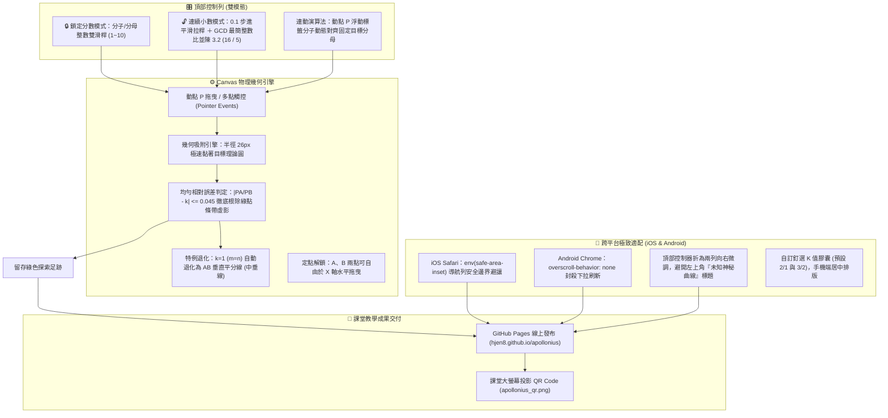

# 🌐 阿波羅尼斯圓 幾何動點軌跡探索實驗室 (Apollonius Circle Interactive Web Lab)

> **專案核心**：高一數學「平面上的直線與圓」之阿波羅尼斯圓 (Apollonius Circle) GGB 級純前端 HTML5 Canvas 互動探究教學實驗室。學生可拖曳動點 P 尋找 $PA / PB = \text{定值}$ 之幾何軌跡，在試誤與爆裂綠光中親身體會「所有滿足比值為定值的點，竟拼成一個完美的圓」之幾何奇蹟。  
> **線上發布**：[`https://hjen8.github.io/apollonius/`](https://hjen8.github.io/apollonius/) (GitHub Pages 永久發布，免密碼、零建置、全平台)  
> **課堂投影**：掃描 `apollonius_qr.png` 即可令全班學生以手機無痛連線。  
> **建立時間**：`2026-11-10` ~ `2026-11-11`  

---

## 🏛️ 系統架構與數學演算法



---

## 🎯 核心演進史 (V1 ~ V15)

1. **V1 ~ V5（基礎探索與單行化）**：
   - 建立 HTML5 Canvas 幾何座標系，動點 P 拖曳即時計算距離 $PA, PB$ 與比值 $PA/PB$。
   - 隱藏初始圓形（防劇透），命中目標比值時噴射亮綠色足跡。
   - 工具列單行化，解鎖 A、B 點於 X 軸自由拖曳。
2. **V6 ~ V8（雙平台全相容大升級）**：
   - 解決手機（iPhone 390px）視野狹窄與 Safari 底部工具列遮擋問題。
   - 注入 `overscroll-behavior: none` 徹底封殺 Android Chrome 下拉刷新重載。
   - 說明框收合為「任務」二字，實體防止長文字折行。
3. **V9 ~ V12（純整數比與平滑連續雙模態）**：
   - 分子分母整數雙滑桿（1~10），徹底解決浮點數除不盡與除以零問題。
   - $k=1$ ($m=n$) 自動切換為「中垂線 (垂直平分線)」退化模式。
   - 0.1 步進平滑拉桿 ＋ GCD 最簡整數比並陳（如 `3.2 (16 / 5)`），兼顧滑動平滑感與兩整數比認知。
   - 動點 P 浮動標籤導入「固定分母對齊法」（如目標為 3/7 時，即時顯示 `某某 / 7`）。
4. **V13 ~ V15（極致穩定、抗抖動與版面微調）**：
   - 實體硬化拉桿容器寬度 (`width: 260px / 195px, flex-shrink: 0`)，徹底消除數字變長時的彈跳抖動。
   - 以純幾何相對誤差 ($|PA/PB - k| \le 0.045$) 取代依賴距離的舊容許度，徹底根除右側綠點條帶虛影。
   - 吸附半徑增強至 26px，提升觸控滑動黏著感。
   - 頂部控制器分折為上下兩列向右避讓，徹底解決左上角「未知神秘曲線」字樣被遮蔽問題。
   - 預設釘選比值依教學直覺精簡為最經典的 2 個值：`2 / 1` 與 `3 / 2`。

---

## 📦 目錄結構

```
E:\AI_Work\Apollonius_Circle/
├── index.html                  # 核心生產力網頁 (GitHub Pages 根目錄)
├── interactive_ggb.html        # GGB 互動原型
├── apollonius_qr.png           # 課堂投影專用 QR Code
├── archive/                    # V1 ~ V15 歷史演進版本備份
│   ├── 阿波羅尼斯圓_互動探索_V1.html
│   ├── ...
│   └── 阿波羅尼斯圓_互動探索_V15.html
├── ANTIGRAVITY.md              # 本專案 SOP 與架構說明檔
├── README.md                   # 專案公開說明
├── VERSION_TREE.md             # 歷史版本樹母檔
└── .gitignore                  # Git 忽略設定
```

---

## 🚀 部署與維護指令

- **修改後即時部署至 GitHub Pages**：
  ```powershell
  cd E:\AI_Work\Apollonius_Circle
  git add index.html
  git commit -m "feat: 更新互動實驗室"
  git push origin main
  ```
- **檢查 Actions 部署狀態**：
  ```powershell
  gh run list --limit 1
  ```
