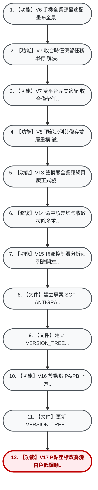

# 🌲 Apollonius_Circle 歷史版本樹 (Project Version Tree)

> **核心定位**：本文件與專案說明書 (`README.md` / `ANTIGRAVITY.md`) 具同等級核心地位。  
> 📌 **當前身處分支**：`main` (HEAD -> `76e7790`)  
> 🚦 **工作區狀態**：✅ 工作目錄整潔 (Clean)  
> 🕒 **最後更新時間**：`2026-11-11 08:14:13`

---

### 1. 視覺化分支分岔樹 (Visual Branch Graph)
*註：垂直由上往下演進，主線以 1, 2, 3 編號，分岔以 1-1, 1-2, 1-1-1 階層式編號，清晰大字不擠壓。*



---

### 2. 時光機回溯與存檔對照表 (Time Machine & Commit Log)
*註：點選或複製時光機指令，可隨時一鍵跳轉回任一歷史版本。*

| 編號 (No.) | 存檔ID (Hash) | 提交時間 | 分支/標籤 | 說明 (Commit Message) | 時光機指令 (前往此版本) |
| :---: | :---: | :---: | :---: | :--- | :--- |
| **12** | `76e7790` | 2026-11-11 08:14 |  `HEAD -> main, origin/main` | 【功能】V17 P點座標改為淺白色低調顯示，PA/PB即時分子改以亮黃色醒目突出 | `git checkout 76e7790` |
| **11** | `7a0bbee` | 2026-11-11 08:07 |  | 【文件】更新 VERSION_TREE.md 記錄 V16 P點座標標籤 | `git checkout 7a0bbee` |
| **10** | `18fe5fb` | 2026-11-11 08:07 |  | 【功能】V16 於動點 PA/PB 下方新增 P 點即時動態座標 P x, y | `git checkout 18fe5fb` |
| **9** | `6b66723` | 2026-11-11 01:10 |  | 【文件】建立 VERSION_TREE.md 歷史版本樹母檔 | `git checkout 6b66723` |
| **8** | `127d7f7` | 2026-11-11 01:10 |  | 【文件】建立專案 SOP ANTIGRAVITY.md、README.md、QR Code 與 V1~V15 歷史歸檔 | `git checkout 127d7f7` |
| **7** | `d2e2b42` | 2026-11-11 00:51 |  | 【功能】V15 頂部控制器分折兩列避開左上副標題，預設釘選比例精簡為2/1與3/2 | `git checkout d2e2b42` |
| **6** | `e6e8bc3` | 2026-11-11 00:35 |  | 【修復】V14 命中誤差均勻收斂拔除多重虛影條帶、加強手機吸附手感、副標題改為定值 | `git checkout e6e8bc3` |
| **5** | `1bfc99a` | 2026-11-11 00:22 |  | 【功能】V13 雙模態全響應網頁版正式發布 0.1平滑步進/兩整數比並陳/固定分母對齊/拉桿防抖動/雙平台相容 | `git checkout 1bfc99a` |
| **4** | `1d9f205` | 2026-11-10 23:16 |  | 【功能】V8 頂部比例與儲存雙層重構 徹底修復手機儲存出鏡無效問題、收合僅留任務兩字、安卓防下拉刷新 | `git checkout 1d9f205` |
| **3** | `d5b2657` | 2026-11-10 23:13 |  | 【功能】V7 雙平台完美適配 收合僅留任務兩字/安卓防下拉刷新/跨平台觸控優化 | `git checkout d5b2657` |
| **2** | `e014cd9` | 2026-11-10 23:11 |  | 【功能】V7 收合時僅保留任務單行 解決折行掉字 | `git checkout e014cd9` |
| **1** | `8d1e47c` | 2026-11-10 23:00 |  | 【功能】V6 手機全響應最適配 畫布全景自適應/單指平移/雙指縮放/收合說明盒/安全底區 | `git checkout 8d1e47c` |
| **-** | `dd774c2` | 2026-11-10 22:41 |  | 【功能】阿波羅尼斯圓 Apollonius Circle 幾何動點軌跡互動探索實驗室 | `git checkout dd774c2` |

---

### 3. 現存分支架構 (Active Branches)
- 🌿 `main` **(HEAD 當前所在)**

---

### 4. 終端完整拓撲圖 (Terminal ASCII Graph)
```text
* 76e7790 (HEAD -> main, origin/main) feat: V17 P點座標改為淺白色低調顯示，PA/PB即時分子改以亮黃色醒目突出
* 7a0bbee docs: 更新 VERSION_TREE.md 記錄 V16 P點座標標籤
* 18fe5fb feat: V16 於動點 PA/PB 下方新增 P 點即時動態座標 P (x, y)
* 6b66723 docs: 建立 VERSION_TREE.md 歷史版本樹母檔
* 127d7f7 docs: 建立專案 SOP ANTIGRAVITY.md、README.md、QR Code 與 V1~V15 歷史歸檔
* d2e2b42 feat: V15 頂部控制器分折兩列避開左上副標題，預設釘選比例精簡為2/1與3/2
* e6e8bc3 fix: V14 命中誤差均勻收斂拔除多重虛影條帶、加強手機吸附手感、副標題改為定值
* 1bfc99a feat: V13 雙模態全響應網頁版正式發布 (0.1平滑步進/兩整數比並陳/固定分母對齊/拉桿防抖動/雙平台相容)
* 1d9f205 feat: V8 頂部比例與儲存雙層重構 (徹底修復手機儲存出鏡無效問題、收合僅留任務兩字、安卓防下拉刷新)
* d5b2657 feat: V7 雙平台完美適配 (收合僅留任務兩字/安卓防下拉刷新/跨平台觸控優化)
* e014cd9 feat: V7 收合時僅保留任務單行 (解決折行掉字)
* 8d1e47c feat: V6 手機全響應最適配 (畫布全景自適應/單指平移/雙指縮放/收合說明盒/安全底區)
* dd774c2 feat: 阿波羅尼斯圓 (Apollonius Circle) 幾何動點軌跡互動探索實驗室
```

---
*💡 由全域工具 `git_version_tree.py` 自動生成與維護，每次收工自動同步更新。*
